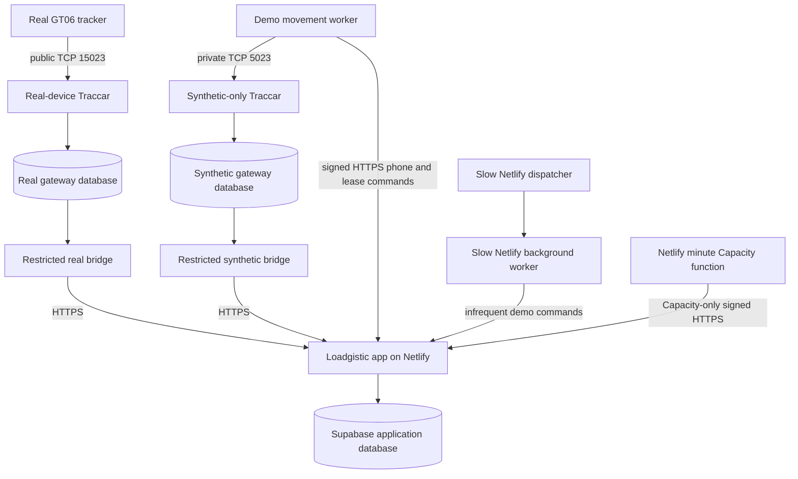

# Demo simulator and GPS hosting plan

**Updated November14, 2026: preferred serverless Capacity runtime and separate
GPS hosting plan; no new hosted activation.** The November13 read-only inspection of the exact
Loadgistic project found it healthy, with the telemetry ingestion/provisioning
functions and hosted-movement control installed. It found zero registered
gateways, devices, assignments or telemetry positions. Hosted movement is
disabled with its kill switch on; Capacity/share/profile/team/duty controls are
also off, without activation or dispatch timestamps. The movement cohort and
queued Capacity steps are empty. Schema presence is not worker installation.
No running GPS endpoint, accepted hosted fix or hosted movement worker is
established by that evidence; an unlinked external host was not probed.

The historical local rehearsals below retain their original evidence scope.
The earlier statement that migration189 was absent from production is obsolete;
the current catalog/control readback supersedes it. No host, DNS, firewall,
billing, secret, database or activation change was made by this audit.

## The short answer

Only the real-device GPS gateway needs a public raw TCP listener. The larger
demo workflow simulator runs authenticated app commands over HTTPS.
Recurring demo GPS movement needs a separate worker with a private GT06 path to
an internal-only synthetic gateway; the phone example uses the existing narrow
app command. Both can run on the selected GPS host without buying a second host.
The private gateway is described in `compose.synthetic.yml`; the physical
gateway is independently deployable with `compose.hosted.yml`. A separate
default-off hosted application command path and database kill control exist;
the control is installed on production and disabled. The recurring movement
worker is an opt-in private profile; its hosted runtime and end-to-end accepted
fixes remain unqualified.

The preferred frequent Capacity runner is now the independent Netlify
`demo-capacity` scheduled function. One native minute invocation signs a request
for at most two oldest due actors. Five actors follow authored
80→60→30→Empty 100 episodes, at least 120 seconds after each target's actual
completion. Expected healthy spacing is about 120–180 seconds per actor; actual
provider timing, execution and pauses can make it longer. It advances one next
phase per claimed actor without catch-up loops, skipped phases or backdating.
Foreground web/native feed reads target 15 seconds. This function publishes
Capacity only; it does not produce or refresh GPS/phone locations.

The standalone `compose.scenario.yml` container remains an optional alternative,
with one due actor per 30-second tick and normally 120–150 seconds per actor.
Run exactly one Capacity scheduler. Stop and verify any external container before
enabling the Netlify replacement; checking the site's environment cannot stop a
different host. The separate Netlify 15-minute dispatcher cannot execute fast
Capacity. Its sharing/profile/team controls remain disabled for initial Capacity
activation; duty and handover remain held because they depended on Manual writes.

Keep the Loadgistic app, minute Capacity function and durable controls on
Netlify and Supabase. Normal app development can use managed Supabase; it does
not require local Docker or a running Traccar gateway. Only the real GPS and
synthetic source services need their separately qualified hosting. The existing
Traccar templates target a measured Linux host with Docker Compose, persistent
storage and the required TCP networking. Real and synthetic stacks may share
that host with independent lifecycle, credentials, databases and backend
networks. No host is selected; Capacity progress does not wait for that selection.

Each Traccar database remains isolated from Supabase. Its restricted bridge is
the only component that forwards normalized GPS events to Loadgistic. The demo
workflow and movement lanes have separate purpose keys and receiving
authorization. Netlify's Capacity function reads its narrow key and calls the
guarded app endpoint; the same-site environment can contain other app settings
and is not physical secret isolation. The independently configured Capacity
container and movement worker receive only their own narrow authority, without
bridge, Traccar API, tracker-command or database credentials. The movement worker
only opens the synthetic gateway's private GT06 socket and signs narrow app
requests. The independent hosted templates have separate real and synthetic Traccar databases,
bridge credentials and Docker networks. Only the real gateway maps host port
`15023` to internal GT06 port `5023`; the synthetic GT06 socket has no host port.
Confirm a physical tracker accepts the public port before issuing any
model-specific server command.

The test distinction matters: the existing GT06 packet simulator is deliberately
loopback-only. Hosted fictional IMEIs need a separately registered
`synthetic_only` gateway and a private listener, with no published socket.
Physical tracker intake requires a non-synthetic gateway. Reusing the public
listener for both would let an Internet sender claim a fictional IMEI; an IMEI
does not establish packet origin. The isolated synthetic stack is configured,
but it is not deployed, provisioned or connected to a hosted application.
Earlier local rehearsals verified an opt-in ten-target GPS/phone run and
five-vehicle Capacity scenario under the then-current contracts. The old direct
one-shot/CLI Capacity writer is now retired; its observations do not qualify
the new catalog2 controller. The finite supervisor and hosted workers are not
deployed production schedulers. A location source
may retain its last saved fix after the one-hour movement lease ends, but its
age label then becomes stale. A hosted demo needs recurring GPS/phone fixes
before claiming that vehicles are moving.

## Which hosting options fit

| Option | Public GT06 TCP | Demo workflow jobs | Fit for the current code |
| --- | --- | --- | --- |
| Supabase Cron / Edge Functions | No inbound device socket | Can schedule/call bounded work | Possible for bounded HTTPS/database work, but adds a second scheduler/runtime pattern and does not host this persistent TCP stack. |
| Netlify Functions | No inbound device socket | Preferred minute Capacity function, at most two due actors; separate slow dispatcher/background lanes | Fits bounded HTTPS Capacity work using the existing durable controller. No Docker or raw GPS service is needed for this lane. |
| Netlify Server, Early Access | No documented raw GT06 listener or Java/Docker deployment for this stack | Long-lived Node HTTP/WebSocket/SSE backend | A current Netlify option for HTTP servers, but not a replacement for these persistent Traccar/PostgreSQL containers. It scales to zero when idle, replaces instances after eight hours and offers temporary instance disk only. |
| Fly.io container | Yes, raw TCP is supported | Could run a separate worker container | Technically viable, but the current Compose deployment needs a Fly-specific split, networking, and persistent-volume setup. It is more provider-specific work than a VM for this existing stack. |
| Standard Linux VM | Yes, with public IPv4 and firewall rules | Private movement container; optional Capacity container instead of the Netlify function | Fits the independent Compose projects. Capacity hosting here is optional. Requires OS patching, monitoring and backup ownership; provider, plan and billing remain unselected. |

Netlify scheduled functions use minute-resolution UTC cron and have a 30-second
execution limit. They run on a schedule only for published deploys, with manual
invocation available in provider tooling for testing; their URL is not a public
trigger. The new Capacity function calls the bounded signed app endpoint
directly with a 20-second deadline. The existing slower dispatcher still uses
a background worker for its own lanes. No long-lived timer or unsupported
thirty-second cron is needed. Supabase Cron remains an alternative for bounded
database-native work, but adding it is unnecessary for this adapter and does
not solve GPS ingress.

### Capacity activation and stopping boundaries

The source adapter is `netlify/functions/demo-capacity.mjs`; it stays off unless
all existing production world/site gates and both new switches are explicit:

| Setting | Required active value or boundary |
| --- | --- |
| `LOADGISTIC_DEMO_CAPACITY_NETLIFY_ENABLED` | `true`; missing/false is off |
| `LOADGISTIC_DEMO_CAPACITY_NETLIFY_KILL_SWITCH` | `false`; missing/true is off |
| `LOADGISTIC_DEMO_WORLD_ENABLED` / `LOADGISTIC_DEMO_WORLD_KILL_SWITCH` | `true` / `false`; other lane database controls remain disabled |
| `LOADGISTIC_DEMO_WORLD_SITE_ID` / `LOADGISTIC_DEMO_WORLD_SITE_ORIGIN` | Exact reviewed production UUID/HTTPS origin matching runtime `SITE_ID` / `URL` |
| `DEMO_CAPACITY_WORKER_SECRET` | Protected distinct 64-hex key, Functions production context only |
| `LOADGISTIC_SCENARIO_WORKER_ENABLED` | Must not be `true` in this deployment; independently hosted containers must also be stopped and verified |

The key signs only purpose `capacity-advance` and
`/api/internal/demo-world/capacity/advance`. The adapter accepts no selected
target, percentage, route or mutation clock. It makes one request, bounds its
response to 8 KiB, and logs only whitelisted aggregate health/counts. The existing
controller owns due times, exact demo membership/sole ownership, source takeover,
leases, predecessor state and immutable receipts. Site-wide environment access
means this is a narrow code/API boundary, not a separate process credential vault.

The shared world HTTP gate can also admit its separate 15-minute dispatcher;
initial Capacity activation must therefore leave profile, business-sharing and
team controls off, with Manual-dependent duty/handover held and movement's own
enable/kill controls off. The Capacity function never invokes those endpoints.
Stopping requires the selected scheduler's stop control and the transactional
database control for accepted/in-flight work. Preserve saved history and leases'
normal expiry/replay rules; do not reset customer records or clear REAL takeover.
Switching deployment requires verification that the previous scheduler stopped.

Focused signed adapter/controller tests pass locally; they do not establish
installed migration221–225 behavior, actual Netlify scheduling, sustained saves
or browser/native acceptance. Those checks and exact hosted activation remain
separate. The normal GitHub runner diagnostic uses isolated Supabase and
rollback-only suites; a diagnostic result is not a full release verdict.

Fly is a TCP option, but its container and storage wiring is not a direct
drop-in for the Compose templates. Its current public-network documentation
requires a TLS handler for shared-IPv4 TCP outside HTTP ports and identifies
non-HTTP protocols without TLS as a reason for dedicated IPv4. The plain GT06
device connection therefore needs a qualified dedicated-IPv4 path; do not
budget it as a free shared-IPv4 service. A conventional VM matches the existing
deployment artifacts directly. A VM is not a fully
managed GPS service: the host still needs patching, disk monitoring, protected
backups, and recovery exercises.

### Provider quote and access still required

The October22 price shortlist is historical and cannot authorize an order.
Requote a measured configuration in the chosen region, including CPU/RAM,
durable disk, public IPv4, backup storage, traffic, tax, payment term and renewal.
For example, DigitalOcean's October26 documentation distinguishes bundled plans
from resource-priced v5 plans, whose continuous monthly total has no monthly
cap and whose IPv4 is a separate line item. Do not reuse an older flat monthly
price for a different configuration. Compare the exact quote with the owner's
budget before creating any resource. No provider, account access, plan or host
has been selected by this reconciliation.

## Size and network starting point

The base dual-gateway Compose limits total 3.5 GiB across six containers; the
opt-in movement worker adds a 128 MiB limit. The alternative Capacity container
adds another 128 MiB only when used instead of the Netlify function;
each optional enrollment relay adds
128 MiB, before the Linux host, filesystem cache and WAL. Do not size a
VM from those limits or assume a 4 GiB machine is sufficient. Measure the
combined staging topology before choosing the final size. This is not a
production capacity claim. Verify actual memory,
disk, connection and event-lag metrics under a sustained test before attaching a
real device. The monthly quote depends on provider, region, IPv4, storage,
backups and traffic; compare the provider's checkout estimate against the
owner's budget before creating anything.

During one local ten-target run, the single Traccar stack measured 269.2 MiB
for Traccar, 85.17 MiB for its database and 29.43 MiB for its bridge, about
384 MiB together. Those are point-in-time local observations, not a hosted
capacity test. Two stacks, the movement worker, the OS and restart headroom
still need staging measurements.

Initially expose only the selected GT06 port: public TCP `15023`. Keep SSH
restricted to the owner's admin network, Traccar API `18082` on host loopback,
and PostgreSQL un-published. Add other protocol ports only after each protocol
is selected and qualified. A device-source firewall allowlist is useful only if
the carrier/APN has stable source ranges; do not assume cellular tracker IPs are
fixed. IMEI alone does not authenticate a device. Do not enable engine or other
physical commands: the actual tracker model/firmware and safety behavior remain
unverified.

### Frequent simulation storage budget — source audit

The reviewed catalog has eight eligible GPS reporters and one phone reporter;
fleet-08 is unavailable. At an ideal 30-second cadence that is 23,040 GPS and
2,880 phone fixes/day. Either Capacity scheduler has a nominal uninterrupted
throughput budget of 2,880 publications/day: two actors per minute on Netlify or
one per 30-second container tick. This is not a separately enforced daily quota.
Completion-based spacing,
outages, pauses and takeover reduce actual throughput. These are source-derived
write budgets, not measured production volume or database size.

| Boundary | Persisted work | Source-defined retention |
| --- | --- | --- |
| Traccar `tc_positions` / `tc_events` | A GPS position per decoded fix; variable additional events. Ideal positions alone are 23,040/day. | No routine retention job is configured in this repository. Disabling original-packet storage does not prune positions. |
| Bridge outbox | A row per upstream position, then delivery updates; ideal 23,040/day. | Healthy maintenance deletes at most 1,000 delivered rows older 7 days per minute. Pending retries have no age/attempt cap. |
| App `telematics_positions` | A unique gateway/event row per accepted GPS fix; ideal 23,040/day. | Bridge maintenance invokes gateway-scoped deletion of at most 1,000 rows older 30 days. Ideal retained window is 691,200 rows before indexes. |
| Demo GPS reservations | A reservation per GPS tick plus correlation update. | Successful START deletes at most 1,000 reservations older 1 day; that cleanup stops when START stops. |
| Synthetic phone / latest Capacity / source controls | Current-row UPSERT/UPDATE, including demo provenance and last-seen state. | No new phone-history row per synthetic tick. Row count is bounded, but WAL, dead tuples and indexes still incur writes, including stationary reports. |
| Motion / gateway HTTP nonces | One row per authorized command/request, not one per GPS fix. | Motion commands delete at most 1,000 nonces older 10 minutes. Bridge PRUNE deletes at most 1,000 gateway nonces older 1 day. |
| Capacity / publication audit / durable step / immutable receipt | Four append rows per successful phase; prior current Capacity expires by UPDATE. At nominal scheduled throughput this is 11,520 append rows/day, about 4.20 million/year. | No routine archive/age prune is configured. One unfinished job per target bounds pending work, not completed history. |

The source has gateway/event uniqueness, device/time and raw-position
`(created_at,id)` indexes, plus latest-Capacity vehicle/update/id indexes.
No time-retention indexes were found for motion reservations/nonces or gateway
nonces; bounded delete batches do not establish bounded scan cost. Persistent
PostgreSQL volumes have no source-defined disk quota. Container logs are capped
at 10 MB ×2 per service and heartbeat tmpfs at 1 MB; those caps do not cover database
history, WAL, backups or indexes. Account-specific privacy erasure is a separate
path and is not a routine retention schedule.

These facts come from `infra/telematics/gateway-outbox.sql`, bridge maintenance
in `worker.mjs`, migrations 151/156/183, normal Capacity publishing in 043 and
the durable 185/224 controller. No live row-size/retention-job query or cleanup
was performed. Production qualification still requires measured row/index
bytes, WAL/autovacuum/bloat and disk-growth evidence, retained backup size,
disk-budget alerts, and a reviewed upstream Traccar retention policy. Without
that policy, ideal GPS positions alone add about 8.41 million rows/year upstream.
Do not infer safe storage cost from source row counts or a healthy container.

## Work that can be prepared before choosing a host

- `infra/telematics/compose.hosted.yml` and `compose.synthetic.yml` define
  independently managed real and fictional projects with pinned Traccar,
  independent databases, bridges and backend
  networks. The fictional GT06, admin API and database have no host ports; real
  ingress exposes only GT06 at the reviewed address. Both hosted bridges have
  device-command dispatch disabled and receive no Traccar API token. This is
  configuration evidence, not an installed gateway or accepted app fix. It has
  an opt-in movement worker profile in the synthetic project. Private HTTP and
  heartbeat readiness checks have source tests; no hosted runtime is qualified.
  The worker has only synthetic backend/egress networks, no host
  port, gateway/database/service-role credential or device-command path. It is
  inert unless its own enable flag is `true`, its own kill flag is `false`, and
  the profile is explicitly selected. Its offline preflight opens no network.
- The application gateway contract, local GT06 decoder rehearsal, bridge
  isolation, and protocol privacy limits are documented in
  [`infra/telematics/README.md`](../../infra/telematics/README.md) and
  [`infra/telematics/GT06_API_MODEL.md`](../../infra/telematics/GT06_API_MODEL.md).
- `netlify/functions/demo-world.mjs` and `demo-world-background.mjs` now provide
  the separate fifteen-minute dispatcher and bounded background worker for slow
  sharing/profile/team lanes. They read Capacity health but cannot claim/execute
  fast Capacity. Manual-dependent duty/handover are held, with zero accepted or
  completed work and their pending/history state retained. The
  internal application route verifies a distinct short-lived HMAC before it
  opens the database. Activation also binds the configured HTTPS origin and
  site ID to Netlify's read-only runtime `URL` and `SITE_ID`; build-time
  `CONTEXT`/`NODE_ENV` values are not assumed to exist at runtime. Set the
  worker variables for the Production Functions context only. Migration 185
  originally restricted execution to five exact synthetic vehicles. Source
  migration 224 upgrades only disabled, never-activated, job-free scheduling to
  a closed twenty-phase catalog; existing activity requires explicit review.
  Its token-bound controller calls the normal Capacity command and records an
  immutable receipt in the same transaction. Migrations 187–188 introduced the
  historical driver-handover lane; migration 223 holds that lane and duty at both
  claim/execution boundaries while preserving valid historical replay.
  Migration 186 prevents the
  existing exact demo shipment from sending real notifications when the demo
  control is enabled. It does not create a new completed shipment or a demo
  login path. Disabled flags are the default. The current hosted catalog has
  the controls installed and disabled; the finite local Capacity run is separate
  historical evidence. The worker logs only counts and
  aggregate lag, never contacts, device IDs or locations.
- `netlify/functions/demo-capacity.mjs` supplies the preferred independent
  minute Capacity schedule. It calls only the narrow signed controller with a
  maximum of two due actors; both adapter flags default off/inert, and existing
  world/site and database controls remain required. Its bounded 20-second
  request/8 KiB response tests cover signing, denial, two independent actors,
  a paused actor beside another actor's progress and sanitized failure without
  an internal retry. These in-process checks do not qualify an installed
  database or published provider schedule. The function's same-site environment
  is not physical secret isolation. It requires no gateway provisioning.
- `compose.scenario.yml` and `Dockerfile.scenario` package only the independent
  optional replacement `synthetic-scenario-worker`. Its profile is opt-in, enable defaults false and
  kill defaults true. It has only HTTPS egress, pinned site/origin and the separate
  `DEMO_CAPACITY_WORKER_SECRET`; it receives no slow world/motion/gateway key or
  database credential. The app accepts that key only for
  `/api/internal/demo-world/capacity/advance` and purpose `capacity-advance`.
  It runs only when the Netlify Capacity scheduler is stopped. A private tmpfs
  heartbeat supplies bounded health without a listener. Offline
  rendering succeeds without any GPS database/gateway variables. These checks
  do not prove an actual deployment, accepted save or visible browser/native run.
- Source migration 225 adds sole-current-demo-owner checks to the final profile
  executor and reserved synthetic Tracking actor readiness. An ordinary co-owner
  blocks new simulated writes and reservation arming; a former demo owner's
  marker does not authorize simulation of a shared customer organization.
  Profile replay/history and private grants remain intact. The new migration
  and rollback rejection tests are pending actual isolated SQL execution.
  Its profile save holds global then profile controls before the job; disable
  waits for an in-flight accepted save and blocks later writes. Operators
  changing both controls in one transaction must use global → profile order.
  Source lock review does not replace the pending two-session concurrency test.
- The provider-independent acceptance checklist is below. Once the provider is
  chosen, qualify the separately authorized movement worker on a staging host
  and add only the provider-specific network/deploy wiring needed for public TCP ingress.
  Preserve the existing public-gateway and application contracts where possible.

## Hosted movement gap and activation contract

The ten-target local movement run is not deployable by changing a hostname.
`src/lib/demo-motion-auth.js` denies production and any non-local Supabase
project; `scripts/telematics/demo-motion-runtime.mjs` denies public HTTPS;
`scripts/telematics/simulator.mjs` denies non-loopback TCP; and the local
supervisor uses a protected file lock and at most a one-hour run. The hosted
synthetic Compose file describes the isolated fictional gateway. A separate HMAC
app route exists in source and its SQL control is installed on production with
the database control disabled and kill switch on. No running hosted movement
worker has been established. The marketplace
slow worker in Netlify handles infrequent lanes; fast Capacity uses its own
minute function or optional replacement container and duty/handover are held.
Neither Capacity scheduler emits GPS or phone fixes.
Leave all existing local refusals in place.

The template already splits the synthetic and real gateways. The synthetic
Traccar GT06 port is container-network only, with a separate persistent gateway
database and restricted bridge; its application registration must be
`synthetic_only`. It has no published TCP, admin or database port. Before a
physical device uses public port `15023`, prove its non-synthetic bridge identity
cannot report for fictional devices. Never point the local simulator at the
public listener or assume an IMEI proves origin. Both hosted bridges now disable
the command lane by explicit configuration. The remaining work is a movement
worker staging rehearsal and activation of the separately authorized app path
under the checks below. The source worker uses a private GT06 connection and
never sends tracker commands. Compose alone
cannot make demo locations move.

The hosted app path and worker need all of these checks:

1. Default-off movement enable and an independent kill switch, separate from
   `LOADGISTIC_DEMO_WORLD_ENABLED`. Compare the exact reviewed Netlify `SITE_ID`
   and runtime `URL` with configured site ID and HTTPS origin, and compare the
   exact `NEXT_PUBLIC_SUPABASE_URL` project reference with the reviewed project.
   Reject previews, a different site/project, URL userinfo, query, redirect or
   insecure transport. The host worker pins the same origin.
2. A protected 64-hex movement HMAC that differs from the marketplace worker,
   gateway, privacy and application credentials. Bind method, path, body,
   timestamp and nonce; use the existing database nonce replay check. The worker
   receives only this HMAC, its fixed cohort and private GT06 destination. It
   receives no Supabase key, gateway token, Traccar API token, customer data or
   tracker-command capability.
3. A default-disabled database control checked transactionally by every hosted
   command and by the underlying GPS/phone lease path. The kill path rejects
   new commands and revokes hosted leases even if a process survives. This first
   version also denies hosted STATUS and STOP while killed; an operator can
   inspect the database through the normal protected operations path. An
   environment flag alone cannot guarantee immediate revocation during a
   running function/container. All writes retain the exact server and SQL
   target allowlists and per-tick owner/driver/device/source/lease checks.
4. Per-target recurring lease acquisition under the existing row lock. Reacquire
   an expired ordinary lease as a new generation only after authoritative
   status and binding checks; never extend an old generation blindly or steal
   a live one. A REAL takeover remains paused until an operator deliberately
   verifies release and resumes that exact target. One failed or taken-over
   target must not pause the other nine. Bound concurrency, cadence to at least
   30 seconds and backoff after app, bridge or TCP failure.
5. A worker stop control that closes sockets, stops timers and releases only
   matching generations. If cleanup cannot reach the app, the one-hour maximum
   lease expires and old packets stay invalid. Retain saved telemetry and source
   choices. Health must report enable/kill state, counts by lease state, last
   accepted GPS/phone age, gateway queue lag, worker heartbeat and bounded
   failure codes. Health and logs must omit coordinates, IMEIs, contacts,
   secrets, nonces, lease IDs and request bodies.

Before activation, inspect the exact hosted ten vehicle UUIDs, fixture owner
and driver keys, selected source, synthetic device binding, gateway ID, current
Capacity visibility and real-installation state with read-only queries. If any
record differs or is missing, stop; do not import/reset fixtures or substitute
another account. Rehearse negative customer/foreign-device and stale-epoch
denial; concurrent workers and crash after GPS reservation; real phone and
physical-device takeover; kill during an in-flight tick; bridge backlog and
restart; public/private saved readback; no notification or real-device command;
and a protected backup/restore. Record source revision and sanitized counts.
Only then can the owner review the exact host, database migration, secret fields,
ingress and rollback. The app command and migration are local code only; no
hosted movement or activation evidence exists yet.

### Historical migration189 local rehearsal

`src/app/api/internal/demo-motion/command/route.ts` accepts only a signed
`POST` on the exact production site. The server requires a separate 64-hex
movement secret, exact Netlify site ID and HTTPS origin, exact Supabase project,
explicit enable and kill flags. It verifies a 30-second HMAC over method,
origin, path, body, timestamp and UUID nonce before opening the database. The
single `hosted_demo_motion_command` RPC checks and consumes the nonce inside the
same transaction as the command. `RESUME` is never accepted.

Migration 189 adds a database control row with `enabled=false` and
`kill_switch=true`. It grants no client access to that row, binds the command
to the ten named vehicle UUIDs, and marks a lease hosted only after a valid
start. The existing lease function locks the control row before vehicle locks
for hosted GPS and phone updates. A kill update waits for in-flight lease
transactions and revokes all hosted running leases in its transaction. It does
not clear history or turn a REAL takeover back into a demo lease. The route
and SQL rehearsal did not establish public deployment or a running worker. The
current installed catalog/control state is recorded at the top of this guide.

Evidence on the disposable `loadgistic_hosted_motion_189_ci` database cloned
from the restored local preview: migration applied, rollback-only SQL
regression passed, and `supabase/rollbacks/189_hosted_demo_motion_control.sql`
refused an enabled control, then restored the previous lease definition and
removed the control/column after it was disabled. In a
measured concurrent check, a synthetic GPS lease held the control row for 15
seconds; the kill update waited about 8.2 seconds, then committed with the
target OFF, its lease cleared and its epoch advanced. This demonstrates the
lock order locally, not a production latency guarantee. App HMAC, deployment
binding, default-off and nonce error cases pass
`tests/demo-motion-hosted.test.mjs`.

### Private movement worker local evidence

`infra/telematics/hosted-motion-worker.mjs` is packaged by
`Dockerfile.motion` in the `synthetic-motion-worker` Compose profile. It has
no host port or route to the real gateway network. The default profile omits
it; even when explicitly selected, the process waits inert unless
`LOADGISTIC_HOSTED_MOTION_WORKER_ENABLED=true` and
`LOADGISTIC_HOSTED_MOTION_WORKER_KILL_SWITCH=false`. Its offline `--preflight`
checks the exact production HTTPS origin/site/project, separate HMAC and
private service name without contacting the app or gateway. It never receives
a Supabase key, bridge credential, Traccar API token or device-command channel.

Each of the ten exact targets is independent. The worker asks the app for
authoritative status, skips REAL and another worker's unexpired lease, opens a
GPS socket only for an exact fictional IMEI, then starts a bounded five-minute
lease. It requires the returned source to match the fixed manifest. Every
30-second fix is reserved through the signed app route before any GT06 packet
is sent; the phone target uses only the app report. The app/database rechecks
owner, driver, assignment, source, lease and kill state for each report. A
malformed response, timeout, changed binding or kill denial sends no later
packet; a failed target releases only its matching generation. Crashes leave
the backend lease to expire, and a restarted worker will not steal a live one.
The route uses wall time and the reviewed OSM local-road catalog so restarting
a window does not jump the demo vehicle back to its first point. Seven road
legs, two explicit stationary courses and one unavailable target remain local
protocol tests, not progress along regional Capacity plans. Unavailable motion
fails before configure/lease/socket, while independent qualified targets continue.
Logs contain bounded counts and scenario/version/step without coordinates.

Focused local evidence: `tests/telematics-hosted-motion-worker.test.mjs`
covers default-off preflight, exact HMAC/target requests, one-shot network
failure, private GT06 login with command rejection, reserve-before-packet,
REAL/live-lease skip, independent target failure, kill-aborted cohort and route
continuity. `tests/telematics-hosted-topology.test.mjs` checks that the worker
is absent from default Compose and, when opted in, has no published port,
real-gateway network or privileged credential. These use mocked app responses
and a fake socket. One additional offline 127.0.0.1 roundtrip uses a real TCP
socket to verify GT06 login, ACK and a position sent only after reservation;
it passed outside the local socket sandbox. Set `REQUIRE_GT06_LOOPBACK=true`
for a required CI run, so an environment that forbids loopback fails rather
than silently treating a skip as evidence. The earlier container rehearsal's
network-none preflight returned `enabled=false` and `deploymentAuthorized=false`.
The new road-catalog and key-isolation source still needs that rebuilt-image
check. CI builds the image and runs the network-none preflight, so a missing
packaged dependency cannot pass by relying on files present only in the checkout.
A real isolated staging stack still must prove Traccar
registration, bridge persistence, app readback and restart behavior before
any hosted activation.

## Before creating a paid host

### Enrollment relay source and activation boundary

The current Add device service performs `GET /api/devices?uniqueId=...`, creates
an absent exact binding with `POST /api/devices`, then independently verifies
`GET /api/devices/{id}`. Its normal admin route does not accept an arbitrary
client-selected gateway/device number. Netlify cannot call the loopback-only
Traccar API in these manifests. Publishing the full API would widen the attack
surface and is not an accepted workaround.

| Choice | Preserves the existing Add device workflow | Required qualification |
| --- | --- | --- |
| Authenticated TLS proxy permitting only canonical `GET /api/devices/{id}` | No; supports verification of an already provisioned/linked binding | Reject every other method/path/query/body/upgrade, bound rate/size/time, redact response fields, and use exact device grants on a separate non-admin read-only user. A separately specified private-provisioning/application-link workflow would still be needed. |
| Narrow enrollment relay, implemented in source | Preserves existing exact lookup/create/verify behavior in HTTP integration tests | Qualify the actual Traccar regular-user token/grants, private upstream, protected files and TLS route before exposure. Existing app admin/owner checks and ambiguous-result reconciliation remain authoritative. No new DB queue or general proxy. |

Traccar6.16 bearer tokens identify a user and expiry rather than route scopes.
Administrator users bypass ordinary read-only/device-read-only checks.
Verification-only principals can be read-only; the implemented enrollment relay
needs device creation and therefore uses a dedicated active regular user with
`readonly=false`, `deviceReadonly=false`, `userLimit=0`, a positive reviewed
device limit, `limitCommands=true` and `disableReports=true`, with no group or
command grants. Restrictions do not replace the hard endpoint allowlist:
`limitCommands` still permits an assigned saved command ID. Never
reuse the isolated local bootstrap administrator token for a public connector.
The relay decodes the pinned token envelope only to locate its claimed user,
then performs an authenticated private self-read, letting Traccar verify the
signature/expiry and checking that exact principal's current restrictions.
No token is put in a URL or returned to the app. Its independent 64-hex relay
token is the app's `apiToken`; the upstream token stays in a protected file on
the host. Both files are outside the image and mounted read-only to UID1000.
The instances are opt-in Compose profiles bound to host-loopback ports18083
and28083, each on its own backend network. See the
[gateway guide](../../infra/telematics/README.md) for exact fields and limits.

The focused suite uses the actual physical/spare registration client against
the HTTP relay and proves exact reuse, timeout-after-write reconciliation,
Pending Link/conflict behavior, strict types/scopes, denied command POSTs,
canonical JSON/path/query checks, response redaction and bounded failures.
These tests mock private Traccar; actual pinned-image principal and enrollment
roundtrips, provider TLS/DNS and production browser readback remain pending.

A host TLS reverse proxy must preserve the original URI, route only the exact
chosen relay hostname's `/api/devices` and single-device paths to its loopback
socket, and deny everything else. Do not route it to Traccar8082 or its admin
port. The app must use an HTTPS `apiUrl` ending `/api/` for that gateway and the
matching relay token. Keep Authorization, cookies, body and private identifier
queries out of access logs. Apply outer abuse limits without rewriting the
operation or forwarding client headers upstream. Review the actual certificate,
hostname, route, credential slots and rollback before activation; no provider
TLS configuration is installed by these source templates.

### Concrete host review fields

Record the chosen account/provider/region, exact quote and permitted operator
access before creating anything. Record a stable public IPv4 and device hostname
with DNS-only routing to the reviewed TCP listener; an ordinary HTTP CDN proxy
does not forward raw GT06. Confirm the actual model supports the chosen hostname
and port, and the carrier/APN can reach them. Retain an independently reviewed
source firewall policy; dynamic carrier IPs require an explicit APN/VPN or other
qualified network decision. Keep the synthetic listener private.

Record each project's exact persistent volume and measured free-disk/WAL growth
under sustained traffic. Back up the consistent Traccar/outbox database and
protected configuration to an encrypted off-host destination, define retention
and the acceptable recovery window, then restore into an isolated project and
measure recovery before activation. Do not claim a recovery time from an empty
database or a successful backup upload. Keep disk, queue-lag and stale-heartbeat
alerts with a named operator; a Docker unhealthy flag alone is not a response.

1. Choose a provider/region that supports inbound TCP `15023`, stable public
   IPv4, Docker Compose, persistent disk, provider firewall rules and recoverable
   backups. Confirm the tracker carrier can reach that region and port.
2. Create the host with the smallest measured-safe configuration, a named
   non-root operator, SSH keys, automatic security updates, disk/CPU/memory
   alerts, and a protected backup destination. Do not expose the Traccar admin
   UI or database.
3. Use a staging hostname/IP and separate synthetic-only and real-device gateway
   identities. Start with the synthetic port private or host-loopback only and
   provision only exact fictional bindings. Use a separate disposable real
   device record and non-synthetic gateway for eventual hardware testing.
4. Run the gateway backup, restore, restart, queue/retry, retention and
   disable/erasure rehearsals on that same host. Verify event age and queue lag
   with sanitized counts. Test that stopping the bridge does not lose queued
   fixes and that restarting it does not create duplicate app events.
5. Only after owner review of exact host, ports, firewall sources, credentials,
   storage/retention, backup and rollback, point the physical tracker at the
   staging endpoint. Keep engine controls disabled.
6. Finish the remaining scenario/notification safety checks, exact-source CI,
   backup and isolated restore, then review the exact database and hosted flag
   changes before activation. Inspect the selected database's current catalog
   and final function definitions; do not replay historical migrations or invent
   missing ledger rows. Production already has the default-off hosted controls;
   source readiness changes do not authorize toggling them or provisioning a cohort.
   Before any
   hosted activation, check each exact target's current actor, assignment,
   sharing, source and valid GPS/phone fix. Exercise pause, retry, concurrent
   run, failure and rollback. Enable the database control and hosted flags only
   after those gates, and verify fresh movement separately from Capacity edits.

### End-to-end qualification evidence

Use two actual synthetic GT06 packets and a phone lease tick to correlate
reservation, decoded gateway row, durable outbox, signed ingest, saved source
projection and authorized UI readback. Measure observed-at/received-at/visible-at
latency and age labels rather than inferring freshness from a green health
probe. The published baseline inspected November13 polls the public web feed
every sixty seconds. The candidate targets fifteen-second foreground web/native
reads, pausing while hidden/backgrounded; deployed observation must identify
which version is under test. Both are polling rather than a push Realtime
subscription. A two-second bridge cycle does not make either UI instantaneous.
Physical phone/background-location behavior and a physical
tracker bench require their own device evidence.

Pause/restart the bridge and app, retain queued fixes, restore delivery without
duplicate events, and prove malformed packets, replay/tamper, foreign devices,
stale assignment/source epochs, REAL takeover and kill prevent invalid updates.
Check saved public/private readback, source/age honesty and notification/command
denial. Record exact source/artifact and the tested environment. No production
movement, public listener or endpoint can be marked complete before those checks
run against the deployed candidate and its actual configured gateway.

## References

- [Netlify scheduled functions](https://docs.netlify.com/build/functions/scheduled-functions/), [function runtime limits](https://docs.netlify.com/build/functions/configuration/) and [background functions](https://docs.netlify.com/build/functions/background-functions/), checked November14, 2026
- [Netlify Server](https://docs.netlify.com/build/server/), [limits](https://docs.netlify.com/build/server/limits/) and [configuration](https://docs.netlify.com/build/server/configuration/), checked November13, 2026
- [Supabase scheduled Edge Functions](https://supabase.com/docs/guides/functions/schedule-functions) and [runtime limits](https://supabase.com/docs/guides/functions/limits)
- [Fly.io public network services](https://docs.fly.io/networking/services) and [resource pricing](https://fly.io/docs/about/pricing/), checked November13, 2026
- [DigitalOcean Droplet pricing](https://docs.digitalocean.com/products/droplets/details/pricing/) and [Cloud Firewalls](https://docs.digitalocean.com/products/networking/firewalls/how-to/configure-rules/)
- [Traccar Docker guidance](https://www.traccar.org/docker/)
- [Traccar6.16 permissions](https://github.com/traccar/traccar/blob/v6.16.0/src/main/java/org/traccar/api/security/PermissionsService.java), [command sending](https://github.com/traccar/traccar/blob/v6.16.0/src/main/java/org/traccar/api/resource/CommandResource.java) and [token implementation](https://github.com/traccar/traccar/blob/v6.16.0/src/main/java/org/traccar/api/signature/TokenManager.java)
- [node-postgres connection and query deadlines](https://node-postgres.com/apis/client)
