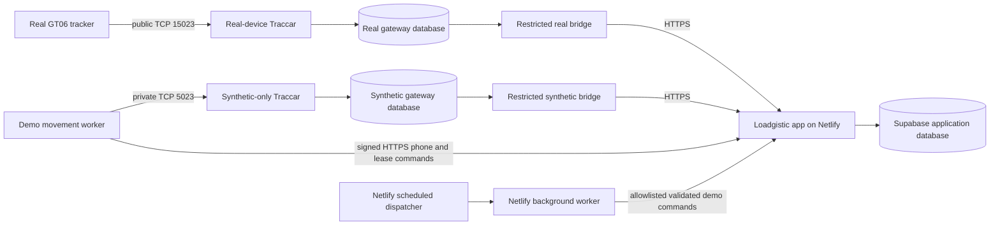

# Demo simulator and GPS hosting plan

**Status: local implementation and provider-neutral hosting plan.** The
marketplace dispatcher, signed background worker, bounded application route and
durable Capacity, notification-isolation, driver-handover, hosted-movement and
broker-sharing migrations (185–190) have passed isolated database and focused
worker checks. All six are installed on the local preview. A finite local
supervisor completed 14 Capacity steps, then stopped; its controls are disabled.
The broker grant/revoke scenario was also exercised and disabled. None of these
changes is applied to production. No paid resource,
public GPS listener, hosted schedule, or production data was created here.

## The short answer

Only the real-device GPS gateway needs a public raw TCP listener. The larger
demo workflow simulator runs scheduled, authenticated app commands over HTTPS.
Recurring demo GPS movement needs a separate worker with a private GT06 path to
an internal-only synthetic gateway; the phone example uses the existing narrow
app command. Both can run on the selected GPS host without buying a second host.
The private gateway is described in the hosted Compose template. A separate
default-off hosted application command path and database kill control are built
and tested locally; migration 189 is installed on the local preview with its
control disabled, but is not installed on production.
The recurring movement worker now exists as an opt-in private Compose profile;
it has not been deployed or connected to a hosted app.

Keep the Loadgistic app and its workflow simulator on the existing Netlify and
Supabase services. Put Traccar, its isolated database, and the restricted bridge
on one small Linux host that supports Docker Compose, persistent storage, a
public IPv4 address, and inbound TCP. That uses one new host for GPS only.

Each Traccar database remains isolated from Supabase. Its restricted bridge is
the only component that forwards normalized GPS events to Loadgistic. The demo
workflow worker and movement worker have separate authorization: neither gets a
bridge, Traccar API, tracker-command or database credential. The movement worker
only opens the synthetic gateway's private GT06 socket and signs narrow app
requests. The hosted template has separate real and synthetic Traccar databases,
bridge credentials and Docker networks. Only the real gateway maps host port
`15023` to internal GT06 port `5023`; the synthetic GT06 socket has no host port.
Confirm a physical tracker accepts the public port before issuing any
model-specific server command.

The test distinction matters: the existing GT06 packet simulator is deliberately
loopback-only. Hosted fictional IMEIs need a separately registered
`synthetic_only` gateway and a private listener, with no published socket.
Physical tracker intake requires a non-synthetic gateway. Reusing the public
listener for both would let an Internet sender claim a fictional IMEI; an IMEI
does not establish packet origin. The isolated synthetic stack is configured,
but it is not deployed, provisioned or connected to a hosted application.
Locally, an opt-in ten-target GPS/phone run and
five-vehicle Capacity scenario have been verified. The initial one-shot runner
uses protected file receipts; the newer finite local supervisor exercises the
durable database jobs and receipts installed on preview. Neither is a deployed
production scheduler. A location source
may retain its last saved fix after the one-hour movement lease ends, but its
age label then becomes stale. A hosted demo needs recurring GPS/phone fixes
before claiming that vehicles are moving.

## Which hosting options fit

| Option | Public GT06 TCP | Demo workflow jobs | Fit for the current code |
| --- | --- | --- | --- |
| Supabase Cron / Edge Functions | No inbound device socket | Can schedule/call bounded work | Possible, but adds a second scheduler/runtime pattern. Edge Functions have a 400-second paid-plan wall limit and 2 seconds of CPU per request. |
| Netlify Functions | No inbound device socket | Scheduled dispatcher plus background worker | Best fit for the workflow simulator: this app already has the same signed dispatcher/background pattern in `netlify/functions/managed-operations.mjs` and `managed-operations-background.mjs`. Scheduled jobs have a 30-second limit; background jobs can run up to 15 minutes. |
| Fly.io container | Yes, raw TCP is supported | Could run a separate worker container | Technically viable, but the current Compose deployment needs a Fly-specific split, networking, and persistent-volume setup. It is more provider-specific work than a VM for this existing stack. |
| Standard Linux VM (for example, a DigitalOcean Droplet) | Yes, with public IPv4 and firewall rules | Workflow jobs stay on Netlify; private GPS movement needs a separate VM container | Best fit for the current `compose.hosted.yml`; it can run the existing isolated stack without moving the application database or adding a new queue platform. It needs normal OS patching, monitoring, and backup ownership. |

Netlify scheduled functions run only on published deploys, not on Deploy
Previews; they can be invoked manually during testing. Their short runtime
makes them a dispatcher, while a signed background function handles a bounded
batch. That matches the existing application pattern and avoids adding Supabase
Cron plus `pg_net` plus another Edge Function just for the simulator. Supabase
Cron remains a reasonable alternative if the workflow later becomes a small
database-native task, but it does not solve GPS ingress.

Fly is a real TCP option, but its container and storage wiring is not a direct
drop-in for the Compose template. Fly's current docs say raw TCP is supported
over public IPv6 and shared IPv4; dedicated IPv4 is required for UDP, not TCP.
GT06 is TCP. A conventional VM is the simpler first comparison because the
existing deployment artifact already matches that model. A VM is not a fully
managed GPS service: the host still needs patching, disk monitoring, protected
backups, and recovery exercises.

### Current VM shortlist (checked October 22, 2026)

The existing dual-gateway Compose stack needs a Linux VM with Docker Compose,
public IPv4 and inbound TCP. These are **comparison prices, not a selected
provider or a production sizing result**:

| Candidate | Advertised base configuration | Qualification before ordering |
| --- | --- | --- |
| [OVHcloud VPS-2](https://www.ovhcloud.com/en/vps/) | 4 vCores, 8 GB RAM, 75 GB NVMe, dedicated IPv4 and daily backup; **from $8.50/month** on the worldwide page | The Configure link defaults to `pricing=upfront12`; verify the actual payment term, tax, region and renewal price at checkout. Use a normal datacentre VPS: OVH says its Local Zone VPS does not support Docker. Confirm the chosen region allows public GT06 TCP and measure memory/disk under the dual stack. |
| [Hetzner CX33](https://www.hetzner.com/cloud/cost-optimized/) | 4 vCPU, 8 GB RAM, 80 GB NVMe; [listed at $9.99/month](https://docs.hetzner.com/general/infrastructure-and-availability/price-adjustment/) before IPv4 and tax | Hetzner's current product page marks CX33 **not available**. Do not base a launch date on it; check stock and the separate IPv4 charge. |
| [DigitalOcean Basic Droplet](https://www.digitalocean.com/pricing/droplets) | 2 vCPU, 4 GB RAM, 80 GB SSD at **$24/month** | Above the owner's rough $20 target and 4 GB may be too small for the dual stack; compare an 8 GB plan only after staging measurements. |

OVHcloud's normal datacentre VPS is the first checkout candidate on current
price and memory, subject to the qualifications above. Do not order a Local Zone
VPS for this Compose deployment. Keep Netlify and Supabase in place; the VM is
for the raw TCP gateway and private synthetic movement worker only. No host is
ordered or deployed by this comparison.

## Size and network starting point

The base dual-gateway Compose limits total 3.5 GiB across six containers; the
opt-in movement worker adds a 128 MiB limit, before the Linux host, filesystem
cache and WAL. Do not size a
VM from those limits or assume a 4 GiB machine is sufficient. Measure the
combined staging topology before choosing the final size. This is not a
production capacity claim. Verify actual memory,
disk, connection and event-lag metrics under a sustained test before attaching a
real device. The monthly quote depends on provider, region, IPv4, storage,
backups and traffic; compare the provider's checkout estimate against the
owner's budget before creating anything.

During one local ten-target run, the single Traccar stack measured 269.2 MiB
for Traccar, 85.17 MiB for its database and 29.43 MiB for its bridge, about
384 MiB together. Those are point-in-time local observations, not a hosted
capacity test. Two stacks, the movement worker, the OS and restart headroom
still need staging measurements.

Initially expose only the selected GT06 port: public TCP `15023`. Keep SSH
restricted to the owner's admin network, Traccar API `18082` on host loopback,
and PostgreSQL un-published. Add other protocol ports only after each protocol
is selected and qualified. A device-source firewall allowlist is useful only if
the carrier/APN has stable source ranges; do not assume cellular tracker IPs are
fixed. IMEI alone does not authenticate a device. Do not enable engine or other
physical commands: the actual tracker model/firmware and safety behavior remain
unverified.

## Work that can be prepared before choosing a host

- `infra/telematics/compose.hosted.yml` now defines distinct real and fictional
  GPS stacks with pinned Traccar, independent databases, bridges and backend
  networks. The fictional GT06, admin API and database have no host ports; real
  ingress exposes only GT06 at the reviewed address. Both hosted bridges have
  device-command dispatch disabled and receive no Traccar API token. This is
  configuration evidence, not an installed gateway or accepted app fix. It has
  an opt-in movement worker profile but no deployed schedule or production
  health gate. The worker has only synthetic backend/egress networks, no host
  port, gateway/database/service-role credential or device-command path. It is
  inert unless its own enable flag is `true`, its own kill flag is `false`, and
  the profile is explicitly selected. Its offline preflight opens no network.
- The application gateway contract, local GT06 decoder rehearsal, bridge
  isolation, and protocol privacy limits are documented in
  [`infra/telematics/README.md`](../../infra/telematics/README.md) and
  [`infra/telematics/GT06_API_MODEL.md`](../../infra/telematics/GT06_API_MODEL.md).
- `netlify/functions/demo-world.mjs` and `demo-world-background.mjs` now provide
  the separate fifteen-minute dispatcher and bounded background worker. The
  internal application route verifies a distinct short-lived HMAC before it
  opens the database. Activation also binds the configured HTTPS origin and
  site ID to Netlify's read-only runtime `URL` and `SITE_ID`; build-time
  `CONTEXT`/`NODE_ENV` values are not assumed to exist at runtime. Set the
  worker variables for the Production Functions context only. Migration 185
  restricts execution to five exact synthetic vehicles, leases due steps, calls
  the normal Capacity command and writes an immutable receipt in the same
  transaction. Migrations 187–188 add one independent, 14-day atomic driver
  handover for two exact demo vehicles. The worker runs that lane after the
  Capacity batch, with a separate one-job limit. Migration 186 prevents the
  existing exact demo shipment from sending real notifications when the demo
  control is enabled. It does not create a new completed shipment or a demo
  login path. Disabled flags are the default; the four migrations are installed
  only on local preview, where the finite Capacity run completed its queued
  jobs, and no production setting is
  active. The worker logs only counts and
  aggregate lag, never contacts, device IDs or locations.
- The provider-independent acceptance checklist is below. Once the provider is
  chosen, qualify the separately authorized movement worker on a staging host
  and add only the provider-specific network/deploy wiring needed for public TCP ingress.
  Preserve the existing public-gateway and application contracts where possible.

## Hosted movement gap and activation contract

The ten-target local movement run is not deployable by changing a hostname.
`src/lib/demo-motion-auth.js` denies production and any non-local Supabase
project; `scripts/telematics/demo-motion-runtime.mjs` denies public HTTPS;
`scripts/telematics/simulator.mjs` denies non-loopback TCP; and the local
supervisor uses a protected file lock and at most a one-hour run. The hosted
Compose file describes the isolated synthetic gateway. A separate HMAC app
route and SQL control now exist in source and on the local preview with the
database control disabled; neither hosted flag is enabled. There is no
running hosted movement worker. The marketplace
scenario worker in Netlify advances Capacity/driver handover; it does not emit
GPS or phone fixes. Leave all existing local refusals in place.

The template already splits the synthetic and real gateways. The synthetic
Traccar GT06 port is container-network only, with a separate persistent gateway
database and restricted bridge; its application registration must be
`synthetic_only`. It has no published TCP, admin or database port. Before a
physical device uses public port `15023`, prove its non-synthetic bridge identity
cannot report for fictional devices. Never point the local simulator at the
public listener or assume an IMEI proves origin. Both hosted bridges now disable
the command lane by explicit configuration. The remaining work is a movement
worker staging rehearsal and activation of the separately authorized app path
under the checks below. The source worker uses a private GT06 connection and
never sends tracker commands. Compose alone
cannot make demo locations move.

The hosted app path and worker need all of these checks:

1. Default-off movement enable and an independent kill switch, separate from
   `LOADGISTIC_DEMO_WORLD_ENABLED`. Compare the exact reviewed Netlify `SITE_ID`
   and runtime `URL` with configured site ID and HTTPS origin, and compare the
   exact `NEXT_PUBLIC_SUPABASE_URL` project reference with the reviewed project.
   Reject previews, a different site/project, URL userinfo, query, redirect or
   insecure transport. The host worker pins the same origin.
2. A protected 64-hex movement HMAC that differs from the marketplace worker,
   gateway, privacy and application credentials. Bind method, path, body,
   timestamp and nonce; use the existing database nonce replay check. The worker
   receives only this HMAC, its fixed cohort and private GT06 destination. It
   receives no Supabase key, gateway token, Traccar API token, customer data or
   tracker-command capability.
3. A default-disabled database control checked transactionally by every hosted
   command and by the underlying GPS/phone lease path. The kill path rejects
   new commands and revokes hosted leases even if a process survives. This first
   version also denies hosted STATUS and STOP while killed; an operator can
   inspect the database through the normal protected operations path. An
   environment flag alone cannot guarantee immediate revocation during a
   running function/container. All writes retain the exact server and SQL
   target allowlists and per-tick owner/driver/device/source/lease checks.
4. Per-target recurring lease acquisition under the existing row lock. Reacquire
   an expired ordinary lease as a new generation only after authoritative
   status and binding checks; never extend an old generation blindly or steal
   a live one. A REAL takeover remains paused until an operator deliberately
   verifies release and resumes that exact target. One failed or taken-over
   target must not pause the other nine. Bound concurrency, cadence to at least
   30 seconds and backoff after app, bridge or TCP failure.
5. A worker stop control that closes sockets, stops timers and releases only
   matching generations. If cleanup cannot reach the app, the one-hour maximum
   lease expires and old packets stay invalid. Retain saved telemetry and source
   choices. Health must report enable/kill state, counts by lease state, last
   accepted GPS/phone age, gateway queue lag, worker heartbeat and bounded
   failure codes. Health and logs must omit coordinates, IMEIs, contacts,
   secrets, nonces, lease IDs and request bodies.

Before activation, inspect the exact hosted ten vehicle UUIDs, fixture owner
and driver keys, selected source, synthetic device binding, gateway ID, current
Capacity visibility and real-installation state with read-only queries. If any
record differs or is missing, stop; do not import/reset fixtures or substitute
another account. Rehearse negative customer/foreign-device and stale-epoch
denial; concurrent workers and crash after GPS reservation; real phone and
physical-device takeover; kill during an in-flight tick; bridge backlog and
restart; public/private saved readback; no notification or real-device command;
and a protected backup/restore. Record source revision and sanitized counts.
Only then can the owner review the exact host, database migration, secret fields,
ingress and rollback. The app command and migration are local code only; no
hosted movement or activation evidence exists yet.

### Migration 189 local rehearsal

`src/app/api/internal/demo-motion/command/route.ts` accepts only a signed
`POST` on the exact production site. The server requires a separate 64-hex
movement secret, exact Netlify site ID and HTTPS origin, exact Supabase project,
explicit enable and kill flags. It verifies a 30-second HMAC over method,
origin, path, body, timestamp and UUID nonce before opening the database. The
single `hosted_demo_motion_command` RPC checks and consumes the nonce inside the
same transaction as the command. `RESUME` is never accepted.

Migration 189 adds a database control row with `enabled=false` and
`kill_switch=true`. It grants no client access to that row, binds the command
to the ten named vehicle UUIDs, and marks a lease hosted only after a valid
start. The existing lease function locks the control row before vehicle locks
for hosted GPS and phone updates. A kill update waits for in-flight lease
transactions and revokes all hosted running leases in its transaction. It does
not clear history or turn a REAL takeover back into a demo lease. The route
and SQL have no public deployment or running worker.

Evidence on the disposable `loadgistic_hosted_motion_189_ci` database cloned
from the restored local preview: migration applied, rollback-only SQL
regression passed, and `supabase/rollbacks/189_hosted_demo_motion_control.sql`
refused an enabled control, then restored the previous lease definition and
removed the control/column after it was disabled. In a
measured concurrent check, a synthetic GPS lease held the control row for 15
seconds; the kill update waited about 8.2 seconds, then committed with the
target OFF, its lease cleared and its epoch advanced. This demonstrates the
lock order locally, not a production latency guarantee. App HMAC, deployment
binding, default-off and nonce error cases pass
`tests/demo-motion-hosted.test.mjs`.

### Private movement worker local evidence

`infra/telematics/hosted-motion-worker.mjs` is packaged by
`Dockerfile.motion` in the `synthetic-motion-worker` Compose profile. It has
no host port or route to the real gateway network. The default profile omits
it; even when explicitly selected, the process waits inert unless
`LOADGISTIC_HOSTED_MOTION_WORKER_ENABLED=true` and
`LOADGISTIC_HOSTED_MOTION_WORKER_KILL_SWITCH=false`. Its offline `--preflight`
checks the exact production HTTPS origin/site/project, separate HMAC and
private service name without contacting the app or gateway. It never receives
a Supabase key, bridge credential, Traccar API token or device-command channel.

Each of the ten exact targets is independent. The worker asks the app for
authoritative status, skips REAL and another worker's unexpired lease, opens a
GPS socket only for an exact fictional IMEI, then starts a bounded five-minute
lease. It requires the returned source to match the fixed manifest. Every
60-second fix is reserved through the signed app route before any GT06 packet
is sent; the phone target uses only the app report. The app/database rechecks
owner, driver, assignment, source, lease and kill state for each report. A
malformed response, timeout, changed binding or kill denial sends no later
packet; a failed target releases only its matching generation. Crashes leave
the backend lease to expire, and a restarted worker will not steal a live one.
The route uses wall time so restarting a window does not jump the demo vehicle
back to its first point. Logs contain aggregate state counts only.

Focused local evidence: `tests/telematics-hosted-motion-worker.test.mjs`
covers default-off preflight, exact HMAC/target requests, one-shot network
failure, private GT06 login with command rejection, reserve-before-packet,
REAL/live-lease skip, independent target failure, kill-aborted cohort and route
continuity. `tests/telematics-hosted-topology.test.mjs` checks that the worker
is absent from default Compose and, when opted in, has no published port,
real-gateway network or privileged credential. These use mocked app responses
and a fake socket. One additional offline 127.0.0.1 roundtrip uses a real TCP
socket to verify GT06 login, ACK and a position sent only after reservation;
it passed outside the local socket sandbox. Set `REQUIRE_GT06_LOOPBACK=true`
for a required CI run, so an environment that forbids loopback fails rather
than silently treating a skip as evidence. The built container's network-none
preflight returned `enabled=false` and `deploymentAuthorized=false`. CI also
builds this image and runs that network-none preflight, so a missing packaged
dependency cannot pass by relying on files present only in the checkout.
A real isolated staging stack still must prove Traccar
registration, bridge persistence, app readback and restart behavior before
any hosted activation.

## Before creating a paid host

1. Choose a provider/region that supports inbound TCP `15023`, stable public
   IPv4, Docker Compose, persistent disk, provider firewall rules and recoverable
   backups. Confirm the tracker carrier can reach that region and port.
2. Create the host with the smallest measured-safe configuration, a named
   non-root operator, SSH keys, automatic security updates, disk/CPU/memory
   alerts, and a protected backup destination. Do not expose the Traccar admin
   UI or database.
3. Use a staging hostname/IP and separate synthetic-only and real-device gateway
   identities. Start with the synthetic port private or host-loopback only and
   provision only exact fictional bindings. Use a separate disposable real
   device record and non-synthetic gateway for eventual hardware testing.
4. Run the gateway backup, restore, restart, queue/retry, retention and
   disable/erasure rehearsals on that same host. Verify event age and queue lag
   with sanitized counts. Test that stopping the bridge does not lose queued
   fixes and that restarting it does not create duplicate app events.
5. Only after owner review of exact host, ports, firewall sources, credentials,
   storage/retention, backup and rollback, point the physical tracker at the
   staging endpoint. Keep engine controls disabled.
6. Finish the remaining scenario/notification safety checks, exact-source CI,
   backup and isolated restore, then review the exact database and hosted flag
   changes before activation. The local preview migration ledger is incomplete;
   do not replay migrations or invent missing ledger rows. Migrations 185–188
   were separately backed up, rehearsed and installed on local preview with
   their control disabled; migration 189 was also rehearsed in a disposable
   clone and installed on local preview disabled, with no production install.
   Before any
   hosted activation, check each exact target's current actor, assignment,
   sharing, source and valid GPS/phone fix. Exercise pause, retry, concurrent
   run, failure and rollback. Enable the database control and hosted flags only
   after those gates, and verify fresh movement separately from Capacity edits.

## References

- [Netlify scheduled functions](https://docs.netlify.com/build/functions/scheduled-functions/) and [background functions](https://docs.netlify.com/build/functions/background-functions/)
- [Supabase scheduled Edge Functions](https://supabase.com/docs/guides/functions/schedule-functions) and [runtime limits](https://supabase.com/docs/guides/functions/limits)
- [Fly.io TCP and UDP services](https://docs.fly.io/networking/udp-and-tcp) and [resource pricing](https://fly.io/docs/about/pricing/)
- [DigitalOcean Droplet pricing](https://docs.digitalocean.com/products/droplets/details/pricing/) and [Cloud Firewalls](https://docs.digitalocean.com/products/networking/firewalls/how-to/configure-rules/)
- [Traccar Docker guidance](https://www.traccar.org/docker/)
